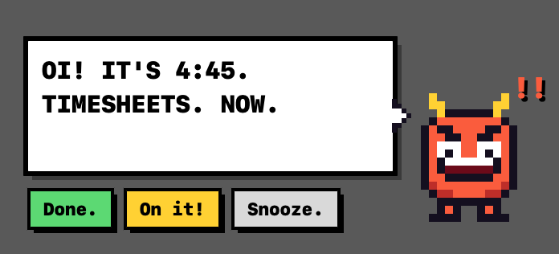

<p align="center"></p>

<h1 align="center">Timesheet Gremlin</h1>

<p align="center">A little pixel gremlin that shouts at you until your timesheets are done.<br>It stays quiet when you're in a Focus mode or on a call.</p>

<p align="center"></p>

## Install

You need an Apple Silicon Mac (M1 or newer). No admin password needed.

**With Claude:** paste this into Claude Code:

```text
Install the Timesheet Gremlin on my Mac. Download and read https://raw.githubusercontent.com/UB-Ben/timesheet-gremlin/main/install.sh, then run it.
```

**Or in Terminal:**

```bash
curl -fsSL https://raw.githubusercontent.com/UB-Ben/timesheet-gremlin/main/install.sh | zsh
```

The gremlin will say hello and ask about Focus. Click **Allow** so it keeps quiet in Do Not Disturb.

## Add your Productive token

This lets the gremlin check your hours, so it can say well done instead of shouting.

1. In Productive, go to **Settings › API integrations** and click **Generate new token**.
2. Copy the token.
3. Click the gremlin in your Mac's menu bar, then click **settings** in its speech bubble.
4. Paste the token into the **Productive** box and press **Check today**. It should show your hours.

Your token stays on your Mac. It's never uploaded anywhere except to Productive itself.

## When it shouts

| Button | What it does |
| --- | --- |
| **Done.** | Checks Productive. Behind for this time of day? It calls you out and comes back in 15 minutes. |
| **On it!** | Opens your Productive timesheet. |
| **Snooze.** | Back in 15 minutes, and a bit crosser each time. (If you opened it yourself with **shout at me now**, this says **Dismiss.** instead and just closes.) |

Hit your daily goal before it's due to shout and you get a well done instead. It also knows your working hours: if you're within two hours of where you should be for the time of day (allowing 30 minutes for lunch), it won't tell you off.

Want it gone? Click the gremlin, or its icon in your menu bar, to send it away.

It keeps quiet when Focus or Do Not Disturb is on, when your mic or camera is in use, and when your screen is locked. It waits and tries again for up to 2 hours.

## Settings

Out of the box it shouts at 4:30pm on weekdays (skipping UK bank holidays), with a daily goal of 7.5 hours. Click the gremlin in your menu bar, then **settings**, to change any of that. You can set:

- what times it shouts (add as many as you like)
- your working hours (start and finish)
- which days, and whether to skip UK bank holidays
- what **On it!** opens
- its noise, or turn the noise off
- its colour
- your daily goal in hours, and your Productive token
- whether it opens at login

## Updates

The gremlin updates itself quietly, checking for a new version every hour. Every update is signed with a key that's kept offline, away from GitHub, and the gremlin checks that signature before installing anything. If an update doesn't check out, it keeps the version you have. To see which version you're on, or to update straight away, open **settings**: the version (v1.15, v1.16 and so on) is under **Install updates** at the top.

Or upgrade from Terminal (your settings and token are kept):

```bash
curl -fsSL https://raw.githubusercontent.com/UB-Ben/timesheet-gremlin/main/install.sh | zsh
```

## Uninstall

Click the gremlin, open **settings**, untick **Open at login**, click **Quit Gremlin**, then drag **Timesheet Gremlin** from the Applications folder in your home folder to the Bin.
